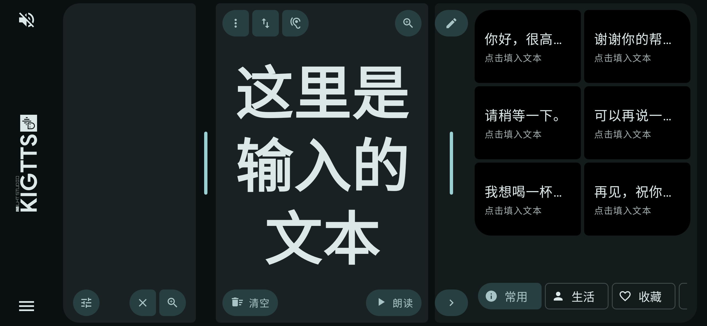

# 主界面横屏

横屏将主页横向排列为“左工具栏 → 聆听字幕 → 大字幕 → 快捷文本”。使用系统屏幕方向切换布局，键盘占用高度不会将竖屏误判为横屏。

[一列亮色布局](images/home-landscape-light.png)展示更宽的大字幕区域。这些截图来自实际 Compose 布局的本地原生渲染。

- 原顶栏成为 64 dp 左栏，横版 Logo 转为竖向展示，保留声音状态、两处插件按钮槽和抽屉入口。
- 开始聆听后，字幕显示在大字幕左侧。两者之间的竖直手柄左右调宽，默认 160 dp；按下即变粗、变长并提供触感。双指缩放、行内字号栏和插件底部按钮继续复用。
- 快捷文本位于右侧。折叠时为竖直胶囊入口，点击或向左拖开后变为竖直手柄；上下两端为编辑与折叠小圆按钮。插件仍使用原 QUICK_PANEL_START / END 区域，过多操作进入更多菜单。长按入口仍由语音输入插件提供。
- 展开后内容始终为纵向滚动网格，分类栏位于底部；左右滑动切换分组。内容滚动不改变面板宽度，调宽仅通过手柄完成。

## 整列吸附

网格以 128 dp 为列宽基准，配合 4 dp 间隔构成整列，左侧操作条 40 dp，两边内容留白共 16 dp。一、二、三列分别停靠在 184、316、448 dp；最多六列，实际数量受窗口宽度限制，并给大字幕预留 220 dp。聆听面板显示时另外预留其最小宽度与手柄空间。

手柄向左拖动增加列数，向右减少。每个停靠点附近 24 dp 范围内使用连续的平滑阻尼；松手吸附最近的整列位置，快速拖动向对应方向的下一停靠点吸附。列数跨档时轻震，触感受全局开关控制。列表条目使用原生位置动画适应列数变化。

折叠和再次展开保留上次列数，重启也保留。横屏列数与竖屏展开高度分别保存；窗口或聆听面板导致列数暂时受限时，不覆盖用户原偏好，空间恢复后自动恢复。背景单独淡入淡出，胶囊与手柄使用稳定的指针节点，插件实时增删按钮不会中断拖动。

## 输入、编辑与旋转

大字幕输入或强制全屏时，左栏、聆听与快捷面板横向收缩并淡出，大字幕填满可用区域；返回后恢复。快捷文本编辑同样占满页面，横屏编辑网格按可用宽度增加列数，拖动目标与详情对话框源坐标来自实际布局。条目详情仍使用全屏容器变换和预测返回。

Robolectric Native Graphics 回归检查横屏区域顺序、列布局、拖拽变形不中断、插件实时扩展、滚动与调宽分离、列数恢复、全屏输入/编辑、聆听调宽与字号控件，以及真实 Activity 横竖配置重建。截图位于 `app/build/previews/landscape-*.png`；帧率和真实键盘/手势兼容性仍需设备验证。
