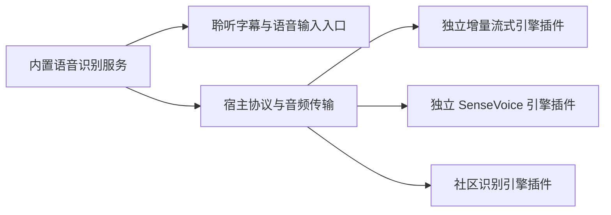

# 语音识别服务

语音识别服务是主程序的内置功能。原 `service.speech-recognition` 包的引擎选择、启停偏好和配置会沿用，旧服务包不再加载。SenseVoice、增量流式、云端识别和社区引擎仍是独立 `PROVIDER` 插件，模型和配置继续保存在各自目录。

## 使用

1. 安装并更新所需的独立识别引擎。
2. 在「设置 → 音频 → 语音识别」选择引擎，或选择「不启用语音识别」。引擎未配置或不可用时，隐藏聆听和识别操作，设置仍可进入。
3. 识别包、下载和引擎参数继续在 [引擎识别包管理](streaming-recognition.md) 中管理。

引擎选择会持久化。未选择、停用或缺少模型时，不会自动切换到其它引擎或语言。识别方式区分为增量流式、分段离线和完整录音。

活动服务直接注册开始/关闭聆听、面板关闭键、连续输入菜单和快捷文本长按入口。选择其它服务后本服务不注册这些功能控件。旧独立字幕/语音输入插件不再承担入口，避免重复控件。没有启用的 SERVICE 时功能按钮/手势不注册；服务没有就绪识别包时，在打开麦克风前拒绝。服务停用或卸载会取消当前录音，主程序不会直接调用 PROVIDER。

切换引擎、启停引擎会先停止当前音频会话再应用新设置。跨插件资源页面使用正常页面栈，返回恢复服务页。服务设置在 `appdata/Kigtts/plugin/plugindata/service.speech-recognition/config/`；停用引擎的规范目录缓存仍在该引擎的 `config/host/asr-catalog.json`。从未加载的已安装 ASR 也可在服务管理页启用。

## 接口和隔离

`AsrInfo.role` 默认为 `PROVIDER`；服务明确使用 `SERVICE`。只有声明 `asr-service` 的服务获得 `PluginEnvironment.recognitionBroker`。代理公开 `providers()`、`recognize(providerId, audio, config)` 和 `recognizeStream(providerId, audioFlow, config)`；目录只包含独立提供者，拒绝服务嵌套和自调用。

主程序负责权限、录音、PCM 管道和展示。服务不链接 sherpa、ONNX、SenseVoice，也不解析引擎模型。增量引擎的中间结果转成可替换的临时片段；非增量引擎只追加最终结果。每次录音固定一个提供者，取消沿服务、broker、引擎逐级传播。双向明确结束标记让进程中断不会被误认为识别正常完成。

服务在宿主运行，引擎继续使用外部插件工作进程和现有权限校验，模型由引擎按需加载。

## 验证

本地回归覆盖服务入口、旧设置迁移、明确停用、非流式断句和实时识别路由。主 APK 内含服务代码；推理库和模型仍随独立引擎分发。

`StreamingRecognitionDeviceTest` 已改为实际主机 → 服务 → broker → 独立在线引擎链路，执行前同签名更新全部既有插件，保留原数据；用中文、英文包验证 EOF 前 Partial 与取消后的再次识别。该链路的当次 Android 结果见 [Release 验证记录](release-testing.md)，之前 Windows 模型功能结果仅代表引擎后端，不等于设备验收。

## 聆听与语音输入

聆听字幕和语音输入统一归属语音识别服务；识别引擎仍是独立插件，由服务调用。`RecognitionEvent.Transcript(committed, partial, sequence, finalized)` 中前文只来自已固化句子，临时修订只替换尾段。固化一次增加一个单调序号，即使两句内容相同也分别发送；空固化清除临时尾段但不新增序号，取消不强行确认临时假设。

默认显示窗口为 12,000 个 UTF-16 字符，可选 256–32,000；前文、尾段及换行合计受限，裁切不留下半个 emoji。旧前文按显示预算移出窗口，但已发送/朗读句子不被临时修订。新固化句子单独最多 32,000 字符，不受较短显示窗口截断；不保存完整录音或无限文本历史。

长按主界面的聆听按钮可以打开快捷设置。语音识别设置、聆听字幕左下角和悬浮快捷菜单都可独立打开字幕浮窗。浮窗与主界面可分别关闭，共用同一次录音；浮窗遵循软件主题、字体和圆角，支持独立字号和多行滚动。快捷语音输入默认开启，连续输入默认关闭。长按快捷文本仍可滑动选择发送、取消、持续识别或发送并朗读。

叠加层出现后仍由主页面根容器跟踪原触摸，避免长按节点被新布局打断；首次冷加载时松手也保留决定，识别就绪后以 EOF 结束录音并等待固化结果。切换持续识别复用同一麦克风和模型会话，已有固化前文先发送，临时尾段等待端点。连续输入逐句发送大字幕，再次长按停止。启动连续输入关闭自动朗读；用户重新打开喇叭后，仅新的固化结果进入朗读队列，临时和旧固化内容不重复朗读。

增量引擎显示“边说边识别”，自行分段的引擎显示“分段识别”。引擎用 `AsrInfo.streaming` 声明识别方式，未填写默认 `INCREMENTAL`；完整录音引擎应声明 `NONE`、`batch = true`，清单只声明 `asr-batch`。识别服务 0.8.3 起也支持这类引擎的持续聆听和输入：按停顿切成完整短句（约 600 毫秒停顿，最长 15 秒且不超过引擎声明的上限），依次交给 `recognize`，只上屏最终结果，不显示逐字假设。纯静音不上传；正常提交识别尾句，取消丢弃未完成的请求。语言仍由实际引擎决定。

“语音识别 → 音频设备 → 系统降噪”默认关闭，切换后在下一次录音生效。支持的设备使用 Android 自带的降噪，不额外增加软件滤波；不支持的设备仍可正常识别。

独立流式引擎按 100ms 切片转换 PCM 并增量解码，避免为大输入块再分配等长 FloatArray。显式使用 2.4 秒空白、1.4 秒句尾静默和 20 秒长句端点；后端未报告端点时，接收音频达到 30 秒也会固化/reset。正常 EOF 只 flush 最后一段；刚完成端点不重复灌静默。reset 复用模型与解码器，取消直接释放 JNI 会话。端点根据停顿与长度分段，不承诺语义标点还原。

配置依据 [Sherpa v1.12.38 官方 Kotlin 接口](https://github.com/k2-fsa/sherpa-onnx/blob/v1.12.38/sherpa-onnx/kotlin-api/OnlineRecognizer.kt)；[特征提取器逐步移出已处理帧](https://github.com/k2-fsa/sherpa-onnx/blob/v1.12.38/sherpa-onnx/csrc/features.cc)，[reset 保留解码上下文](https://github.com/k2-fsa/sherpa-onnx/blob/v1.12.38/sherpa-onnx/csrc/online-recognizer-transducer-impl.h)。本地与模拟后端测试不代替真实麦克风、跨进程、浮窗和连续发声检查；当前安装与设备结果统一记录在 [Release 验证记录](release-testing.md)。

服务设置通过 API9 SettingsEntry 加入“音频”卡片，共用设置的分组、圆角和按压反馈；页面预加载，重进不重放全部条目入场动画。正式自动化入口为 listen、close、input、continuous，供已授权 AppBroker/Agent 调用；引擎选择、资源导入或确认按钮不会因此全部开放。UI 失效可刷新当前快照，不重启识别引擎。

## 语音输入释放区（API 10）

释放按钮是围绕发送区的同心弧形胶囊，选中时长度和端部圆角共用无回弹进度连续变化。端部用与内外圆弧相切的真实圆角，滑动命中区固定，不随外形动画反复切换选中项。图标与每个字沿胶囊中心弧放置，分别按所在位置的切线旋转，长标签按可用弧长省略。自动朗读开启时提供取消、持续识别；关闭时额外提供发送并朗读。横屏以竖屏逆时针90度映射，文字与图标保持可读。持续识别时主界面入口显示「长按停止识别」，长按直接停止。没有识别到文字时静默结束，权限、引擎、录音和真正失败仍明确提示。

插件通过 `UiAction(slot=VOICE_INPUT_RELEASE)` 接入最多五个额外释放按钮，支持 `buttonStyle=ICON` 或 `ICON_TEXT`，排序沿 action.order。滑动释放或点击都派发给该插件 action，当前识别文字由 `context.inputs["voiceText"]` 传入；宿主先关闭本次输入，插件决定后续处理。屏幕较窄时收起文字保留图标及完整无障碍名称。
