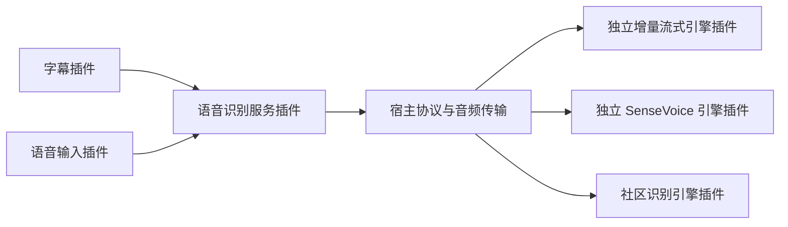

# 语音识别服务

`service.speech-recognition-0.7.0.kigplugin` 为独立 MIT 服务插件，API8。它管理识别引擎并转发标准识别请求。SenseVoice、增量流式以及后续社区引擎都是独立 `PROVIDER` 插件，自己的代码、模型、下载与配置始终属于各自数据目录。

## 使用

1. 同发布者更新主程序和原有外部插件为 API8 / 0.7.0，保留原模型与配置。API6 或更早的二进制需要重新构建。
2. 安装、启用“语音识别服务”及需要的独立识别引擎。在插件管理中选用识别服务，或在服务页点击“设为应用识别服务”。启用服务后，原主界面识别引擎选择会迁移为服务选择。
3. 从右侧抽屉进入“语音识别服务”。可排序、启停和选用引擎；条目详情打开对应引擎的识别包/资源页面。增量流式的多语言包继续在 [引擎识别包管理](streaming-recognition.md) 中管理。

未明确选用引擎时，服务优先使用已就绪的增量流式提供者，再考虑分段离线和完整录音。列表排序仅控制显示，不改变默认优先顺序。一旦手动选用，选择会持久化；目标停用、缺模型或失败时报告不可用，不悄悄换引擎或语言。不同引擎的识别方式在管理页明确区分为增量流式、分段离线、完整录音。

字幕和语音输入声明 `requires = [RECOGNITION_SERVICE]`。没有启用的 SERVICE 时，功能按钮/手势不注册；插件管理显示缺少依赖，低频配置页面仍可打开。服务没有就绪引擎时，调用在打开麦克风前拒绝。服务停用或卸载会取消当前录音并收起聆听面板，主程序不会退回直接调用 PROVIDER。

切换引擎、启停引擎会先停止当前音频会话再应用新设置。跨插件资源页面使用正常页面栈，返回恢复服务页。服务设置在 `appdata/Kigtts/plugin/plugindata/service.speech-recognition/config/`；停用引擎的规范目录缓存仍在该引擎的 `config/host/asr-catalog.json`。从未加载的已安装 ASR 也可在服务管理页启用。

## 接口和隔离

`AsrInfo.role` 默认为 `PROVIDER`；服务明确使用 `SERVICE`。只有声明 `asr-service` 的服务获得 `PluginEnvironment.recognitionBroker`。代理公开 `providers()`、`recognize(providerId, audio, config)` 和 `recognizeStream(providerId, audioFlow, config)`；目录只包含独立提供者，拒绝服务嵌套和自调用。

核心只负责规范数据、权限、录音和 PCM 管道。服务不链接 sherpa、ONNX、SenseVoice，也不解析引擎模型。Started/Partial/Final 由目标引擎原样产生；服务不增加它没有的流式能力。每次录音固定一个提供者，取消沿服务、broker、引擎逐级传播。双向明确结束标记让进程中断不会被误认为识别正常完成。

服务与引擎各使用独立工作进程，当前最多同时启用 8 个外部插件，模型由引擎按需加载。仍是同 UID 的崩溃隔离，沿用现有可信插件限制。

## 验证

本地回归覆盖依赖出现/移除、只有独立引擎时不打开麦克风、服务优先选择、目录授权/禁止循环调用、冷流路由、取消传播、禁用后不换后端、持久化排序与选择、跨插件资源页、结束帧中断判断，以及六个 API8 实物包的签名/有效载荷。识别服务产物不含本地推理库或模型，主 APK 不含服务/引擎实现。

`StreamingRecognitionDeviceTest` 已改为实际主机 → 服务 → broker → 独立在线引擎链路，执行前同签名更新全部既有插件，保留原数据；用中文、英文包验证 EOF 前 Partial 与取消后的再次识别。本轮 ADB 没有设备，因此该新跨进程链路尚未完成 Android 真机验收，之前 Windows 的模型功能结果仍仅代表引擎后端。
